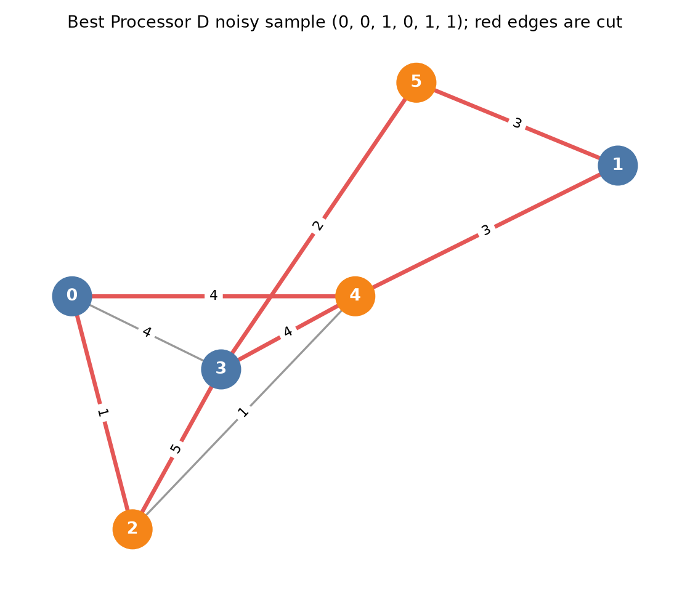
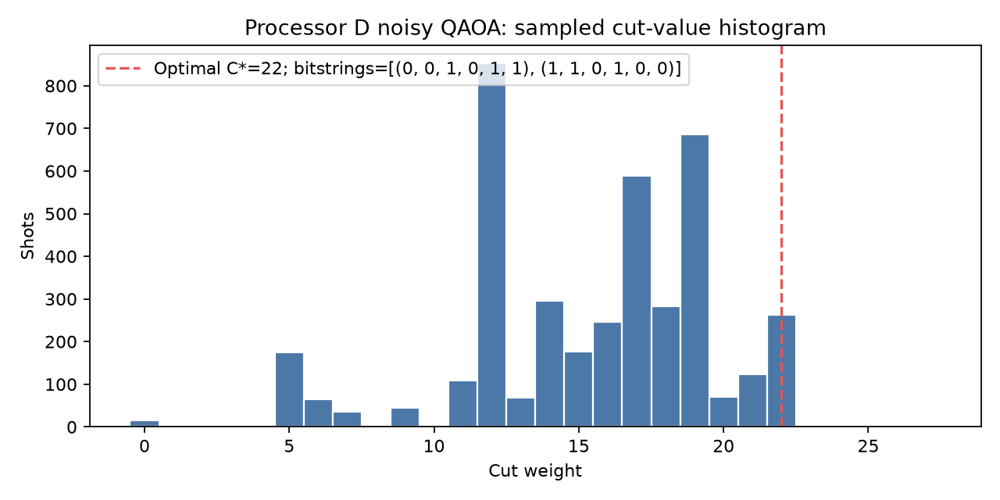
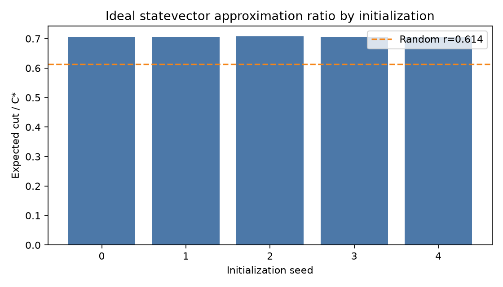
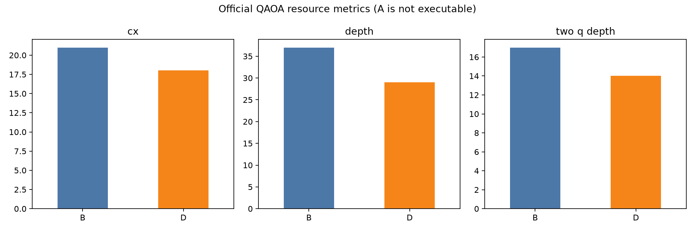

# QFF 2026 Phase 2 Final Report — PS-O1

**Team:** Quantum Drifters

**Problem:** Quantum Optimization of Network Partitioning Using QAOA

**Locked instance:** `data/instance.json`
**Frozen Processor D SHA-256:** `8b88e1f5ced09531fe674cc48731162fdbf7db72b915bf4e44be5e608116a1e8`

## 1. Problem and formulation

The six-vertex weighted graph is loaded from the PS-O1 data file. For binary group assignments $x_i\in\{0,1\}$, the objective is

$$C(x)=\sum_{(i,j)\in E} w_{ij}(x_i+x_j-2x_ix_j),\qquad \max_x C(x).$$

The QUBO minimized by brute-force verification is $-C(x)$. Its symmetric matrix uses $Q_{ii}=-\sum_j w_{ij}$ and $Q_{ij}=Q_{ji}=w_{ij}$, with zero constant, and was asserted equal to $-C(x)$ for every one of the 64 assignments. With $x_i=(1-z_i)/2$, the positive-cut Hamiltonian is $H_C=\sum w_{ij}(I-Z_iZ_j)/2$ and is maximized; $H_B=\sum_i X_i$. The p=1 cost implementation uses `CX-RZ(-gamma*w)-CX`, which equals the required cost evolution up to a global phase.

Exact enumeration found total edge weight 27, classical optimum $C^*=22$, and the complete optimal set `[(0, 0, 1, 0, 1, 1), (1, 1, 0, 1, 0, 0)]`. Uniform random enumeration gives mean 13.500, $r_{random}=0.613636$ (0.614), and $P_{opt,random}=0.031250$ (0.031).

The p=1 angles were optimized once per initial seed using COBYLA, maximum 200 iterations, and exact statevector expected cut. This avoids shot noise during optimization while keeping the final hardware comparison sampled:

| Seed | Exact expected cut | $r$ |
|---:|---:|---:|
| 0 | 15.493620 | 0.704255 |
| 1 | 15.532392 | 0.706018 |
| 2 | 15.557583 | 0.707163 |
| 3 | 15.493620 | 0.704255 |
| 4 | 15.551533 | 0.706888 |

Across seeds, mean $r=0.705716$ and population standard deviation $=0.001251$. The best optimized seed was 2; the same resulting angles were used in every processor evaluation.

## 2. Bell-state results and interpretation

The organizer Bell routine measured XX, YY, and ZZ for an adjacent physical pair `(0, 2)` (distance 1) and farthest pair `(0, 1)` (distance 2), each under ideal and official noisy conditions, for 4096 shots per basis. Fidelity and its standard error use $F=(1+\langle XX\rangle-\langle YY\rangle+\langle ZZ\rangle)/4$ and the quadrature formula:

| Pair | Distance | Condition | XX | YY | ZZ | Fidelity |
|---|---:|---|---:|---:|---:|---:|
| 0-2 (adjacent) | 1 | ideal | 1.0000 ± 0.0000 | -1.0000 ± 0.0000 | 1.0000 ± 0.0000 | 1.0000 ± 0.0000 |
| 0-2 (adjacent) | 1 | noisy | 0.9458 ± 0.0051 | -0.9521 ± 0.0048 | 0.9551 ± 0.0046 | 0.9633 ± 0.0021 |
| 0-1 (farthest) | 2 | ideal | 1.0000 ± 0.0000 | -1.0000 ± 0.0000 | 1.0000 ± 0.0000 | 1.0000 ± 0.0000 |
| 0-1 (farthest) | 2 | noisy | 0.9443 ± 0.0051 | -0.9341 ± 0.0056 | 0.9385 ± 0.0054 | 0.9542 ± 0.0023 |

Ideal fidelity is 1.0000 for the adjacent pair and 1.0000 for the farthest pair. The measured noisy fidelities are 0.9633 and 0.9542, respectively. The noisy gap reflects the organizer depolarizing and readout channels; routing a non-adjacent CX can add entangling operations and their associated error exposure. In this D graph, the distant pair's measured extra CX count is 3 relative to the adjacent pair in the ZZ circuits. The official simulator applies 0.5% two-qubit depolarizing error per CX, 0.1% one-qubit depolarizing error, and 1% symmetric readout bit-flip. Readout affects both pairs, while routing can compound two-qubit error exposure for the distant pair. The synthetic model has no T1/T2 drift or crosstalk, so hardware effects beyond the specified channels are not represented; the report does not assume the distant fidelity must be worse unless the measured values show it.

## 3. Processor D design and measured justification

Before designing D, the optimized circuit was measured on the references: Processor A has 5 physical qubits and cannot execute the six-qubit circuit. Processor B measured 1 routed SWAP, 3 CX overhead, and depth 37. D freezes a six-qubit topology equal to the nine locked interaction edges, with maximum degree four and the official noise rates. The organizer validator returned an empty error list.

Measured D resources are 0 SWAP, 0 CX overhead, and depth 29; thus the intended routing reduction was verified. The exact ideal statevector quality is identical for B and D at $r=0.707163$. At this equal ideal quality, D uses 14.29% fewer transpiled CX, 21.62% less circuit depth, and 17.65% less two-qubit depth than B. The design is intentionally specialized to PS-O1; its degree-four connectivity may be less useful for other workloads and real hardware may face additional crosstalk.

## 4. Results on A/B/D, ideal/noisy, against baselines

The primary ratio is the sample mean cut divided by $C^*$; $r_{best}$ is the largest sampled cut divided by $C^*$; $P_{opt}$ counts either optimal complementary assignment. Every executable condition uses 4096 shots and the same optimized parameters.

| Processor | Condition | Executable | Best cut | $r$ | $r_{best}$ | $P_{opt}$ | Random $r$ / $P_{opt}$ |
|---|---|---:|---:|---:|---:|---:|---:|
| A | ideal | no (6 needed; 5 available) | — | — | — | — | 0.614 / 0.031 |
| A | noisy | no (6 needed; 5 available) | — | — | — | — | 0.614 / 0.031 |
| B | ideal | yes | 22.0 | 0.7118 | 1.0000 | 0.0730 | 0.614 / 0.031 |
| B | noisy | yes | 22.0 | 0.7015 | 1.0000 | 0.0698 | 0.614 / 0.031 |
| D | ideal | yes | 22.0 | 0.7066 | 1.0000 | 0.0696 | 0.614 / 0.031 |
| D | noisy | yes | 22.0 | 0.6975 | 1.0000 | 0.0642 | 0.614 / 0.031 |

Processor A is reported as `not executable: needs 6 qubits, has 5`; the locked graph remains unchanged. Its two required condition rows are present but no results are fabricated. B noisy measured $r=0.701483$ and $P_{opt}=0.069824$; D noisy measured $r=0.697521$ and $P_{opt}=0.064209$. Ideal finite-shot ratios were B 0.711847 and D 0.706610. Noise-related changes (noisy minus ideal) are B $\Delta r=-0.010365$ and $\Delta P_{opt}=-0.003174$; D $\Delta r=-0.009089$ and $\Delta P_{opt}=-0.005371$. All values are in `results/tables/results.csv`, `results/tables/quality.csv`, and `results/tables/noise_gaps.csv`.

Official resource metrics from `circuit_metrics` on the bound circuit with measurements:

| Processor | Logical qubits | Physical qubits | Logical CX | CX | One-qubit gates | Depth | Two-qubit depth | SWAPs | CX overhead |
|---|---:|---:|---:|---:|---:|---:|---:|---:|---:|
| A | N/A | N/A | N/A | N/A | N/A | N/A | N/A | N/A | N/A |
| B | 6 | 9 | 18 | 21 | 57 | 37 | 17 | 1 | 3 |
| D | 6 | 6 | 18 | 18 | 57 | 29 | 14 | 0 | 0 |

The A row is non-executable because the processor has one fewer qubit than the unmodified problem. B routing increases CX/depth relative to D; the noisy quality difference is measured in the benchmark table rather than inferred from gate counts alone. Relative to the random baseline, the QAOA noisy results are +0.087846 in $r$ for B and +0.083884 for D.

### Results figures

Processor coupling maps: [A](results/figures/processor_A_coupling.png), [B](results/figures/processor_B_coupling.png), and [D](results/figures/processor_D_coupling.png).

## 5. Trade-offs, limitations, and next improvements

The circuit is limited to p=1 and only five initializations; the observed across-seed standard deviation is 0.001251, which quantifies optimizer sensitivity for these starts but not all possible optimization error. Ideal/noisy sampling has finite-shot uncertainty at 4096 shots. The local Aer model is synthetic and omits calibration drift, crosstalk, leakage, and pulse scheduling. Processor D is tailored to the PS-O1 interaction graph, so its benefits should not be generalized to unrelated graphs.

Evidence-based next steps are to repeat the five-start optimizer with a larger preregistered seed set, compare p=2 as a separately labeled experiment under the same runtime budget, and test topology robustness on additional locked graph instances. The observed B and D noise-related changes in $r$ are -0.010365 and -0.009089; mitigation work should be prioritized based on these measured gaps rather than assumed benefits. Any physical-hardware conclusions require calibration data; this submission reports only the organizer-defined simulator results.

## Reproducibility

The notebook loads the graph from `data/instance.json`, imports the unmodified organizer utilities, records all seeds, validates the frozen D JSON, and regenerates tables and figures. The exact Processor D file hash is `8b88e1f5ced09531fe674cc48731162fdbf7db72b915bf4e44be5e608116a1e8`. Run `python -m venv opt-env`, activate it, install `requirements.txt`, then execute `jupyter nbconvert --execute --to notebook main.ipynb`. The explicit output format is required by current nbconvert releases.
